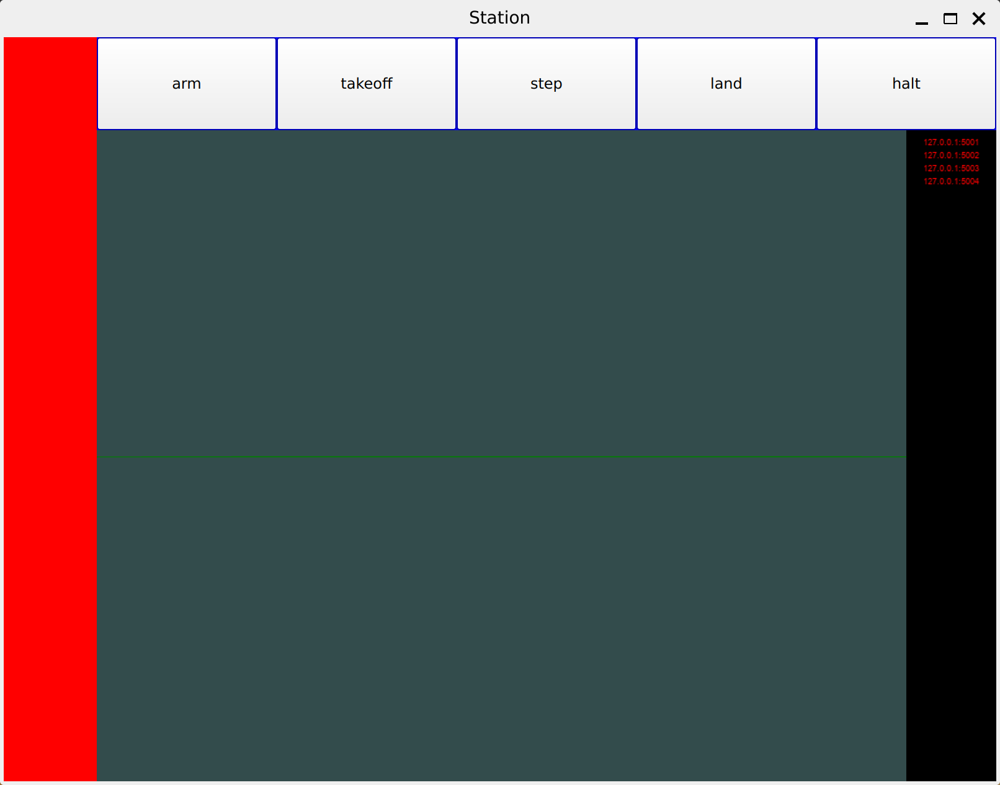
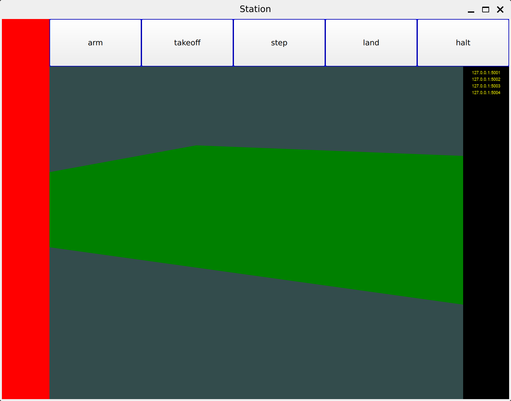

# Lightshow Walkthrough

The lightshow software is composed of two main parts: the drone code and the ground station.

To start, make sure the lightshow software is installed as detailed in
the [installation instructions](installation/install.md).

Run the ground station by typing the following command into a terminal:
```
uv run station_opengl.py
```

You should see something along the lines of this:



Click and drag the left mouse button in the center of the window to rotate the perspective. Click and drag the right mouse button to pan the view.

The observant viewer will notice that on the right bar, there appear to be four loopback-address/port combinations that are currently in red. This is because the respective drones are not running. To run the drones, run the following commands, each in a new terminal:

```
uv run main.py -i 1
uv run main.py -i 2
uv run main.py -i 3
uv run main.py -i 4
```

Now that the drones are running, the loopback-address/port combinations are in yellow, meaning that the drones are connected and that they are ready to be armed:



To arm the drones, click the "arm" button at the top. 
Here is the result of arming the drones:


Then, hit the takeoff button! You can step the drones through time, land them, or even halt them.